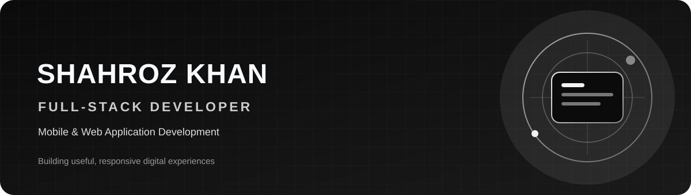

  

  

    <a href="https://shahrozkhan-dev.netlify.app/">Portfolio</a>
    &nbsp;|&nbsp;
    <a href="https://github.com/shahrozkhan-tech">GitHub</a>
    &nbsp;·&nbsp;
    Karachi, Pakistan
  

## About

I'm a full-stack developer with a diploma in Mobile App and Web Development. I build responsive web experiences and practical applications, working across user interfaces, server-side features, and data.

## Tech stack

- **Frontend:** HTML, CSS, JavaScript, React, Bootstrap
- **Backend:** Node.js, Express
- **Data:** MongoDB, Supabase
- **Tools:** Git, GitHub, Vercel

## Selected projects

| Project | Overview |
| --- | --- |
| [HCM-LITE](https://github.com/shahrozkhan-tech/HCM-LITE) | Human resources workflows and dashboards for administrators, HR teams, and employees. |
| [MaintainIQ-Supabase-Version-](https://github.com/shahrozkhan-tech/MaintainIQ-Supabase-Version-) | Maintenance management with Supabase-backed data and a responsive dashboard. |
| [Stock-Ledger](https://github.com/shahrozkhan-tech/Stock-Ledger) | Inventory tracking with stock management and reporting workflows. |
| [DropSpace](https://github.com/shahrozkhan-tech/DropSpace) | A file-sharing app with Supabase-backed storage and sharing features. |
| [Portfolio-advance-version-](https://github.com/shahrozkhan-tech/Portfolio-advance-version-) | A responsive portfolio showcasing web projects and interface work. |

## Education

**Diploma in Mobile App and Web Development**

## Connect

Visit my [portfolio](https://shahrozkhan-dev.netlify.app/) or explore my [repositories](https://github.com/shahrozkhan-tech?tab=repositories).
